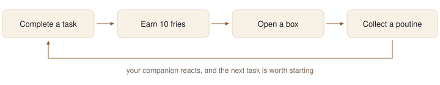
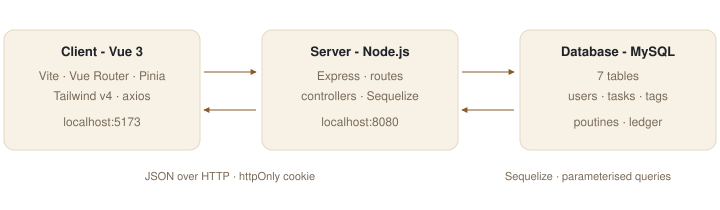

# Proposed solution

## Overview

**Poutine Routine** is a to-do application with a small collection game.

The task side is a normal task manager: a kanban board with three columns, tags, due dates,
priorities, filters, and a table view. The reward side is short: a finished task gives **fries**,
fries buy a **box**, and a box gives a random **poutine**. A poutine is a pixel-art character with
a name and a rarity. The user picks one poutine as a companion. It stays on screen and reacts to
the tasks.

Three rules keep the product simple:

- the task list works even if the user ignores the game;
- there is one currency and one thing to buy with it;
- one image is enough to add a poutine, extra images come later.

## Core loop

## Scope

| Priority | Features |
|:--------------|:-------------------------------------------------------------|
| Must have | Register, log in, log out, protected session. Task CRUD with title, description, status, due date, priority, tags. Kanban board with drag and drop and a keyboard equivalent. Tag filter. Fries on completion. Boxes and collection. Countdown and overdue alert. |
| Should have | Table view. Daily goal and streak. Companion with moods. Per-poutine effects. Dark theme. |
| Could have | Box opening animation, statistics, browser notifications, search. |
| Will not have | Sharing, multiple boards, real-time sync, password reset by email, third-party sign-in, mobile application. |

## Security approach

The application stores personal data. It also runs a small economy, and a user has a reason to
cheat it. We handle both from the start.

| Measure | Reason |
|:--------------------------------------|:----------------------------------------------|
| Passwords hashed with bcrypt | A stolen database gives no usable password |
| Session JWT in an `httpOnly`, `SameSite` cookie, never in `localStorage` | JavaScript cannot read the token, so an XSS flaw cannot steal it |
| Secrets and database credentials in environment variables | A secret in the repository is public to the team and to anyone who clones it |
| Authentication middleware on the whole API | A new route is protected by default |
| Every query filtered by the user id from the token | A user cannot read or edit the tasks of another user |
| Server-side validation of every input | We do not trust the client |
| Same error message for unknown email and wrong password | Different messages tell an attacker which accounts exist |
| Rate limit on login and registration | Brute force becomes too slow to be useful |
| `helmet` headers, CORS limited to the client origin | Reduces browser-side attacks |
| The server computes the rewards, the client never sends an amount | The client cannot create fries |
| One SQL transaction to debit fries and give the poutine, with a condition on the balance | Two clicks at the same time cannot spend the same fries twice |
| Random draw on the server with a cryptographic generator | The client cannot choose its poutine |
| A task pays only once, stored in a timestamp | Unchecking and rechecking a task gives no new fries |

## Architecture

| Layer | Choice | Reason |
|:--------|:------------------------|:--------------------------------------------|
| Front end | Vue 3 with Vite | Required by the course and used in the lectures |
| Routing | Vue Router 4 | Needed to protect the pages |
| State | Pinia | Official state library for Vue 3 |
| Styling | Tailwind CSS v4 with Primer colour tokens | Allowed by the brief, taught in class, and one file changes the whole theme |
| HTTP | axios, one shared instance with `withCredentials` | The session cookie must be sent with each request |
| Back end | Node.js with Express | Required by the course |
| ORM | Sequelize with `mysql2` | Taught in class. It gives parameterised queries and model validation |
| Database | MySQL 8, configured by each developer | Required by the course |
| Auth | bcryptjs, jsonwebtoken, cookie-parser | The stack shown in the course, plus the measures above |

The repository holds `client/`, `server/` and `docs/`. Everything runs locally. We do not plan to
deploy. The course teaches authentication in lesson 9, two weeks before the last milestone, so we
will start it earlier with the course material that is already online.
