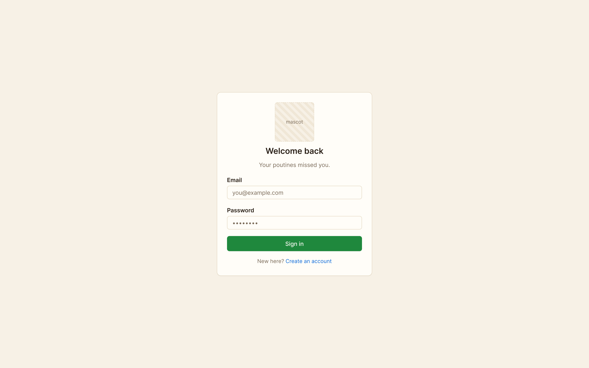
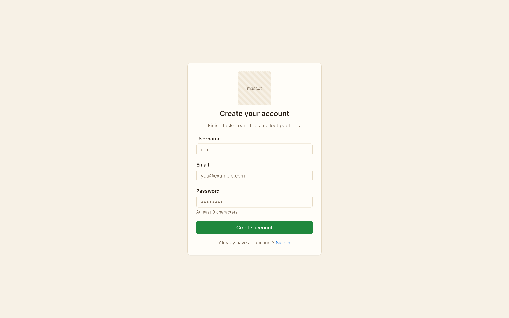
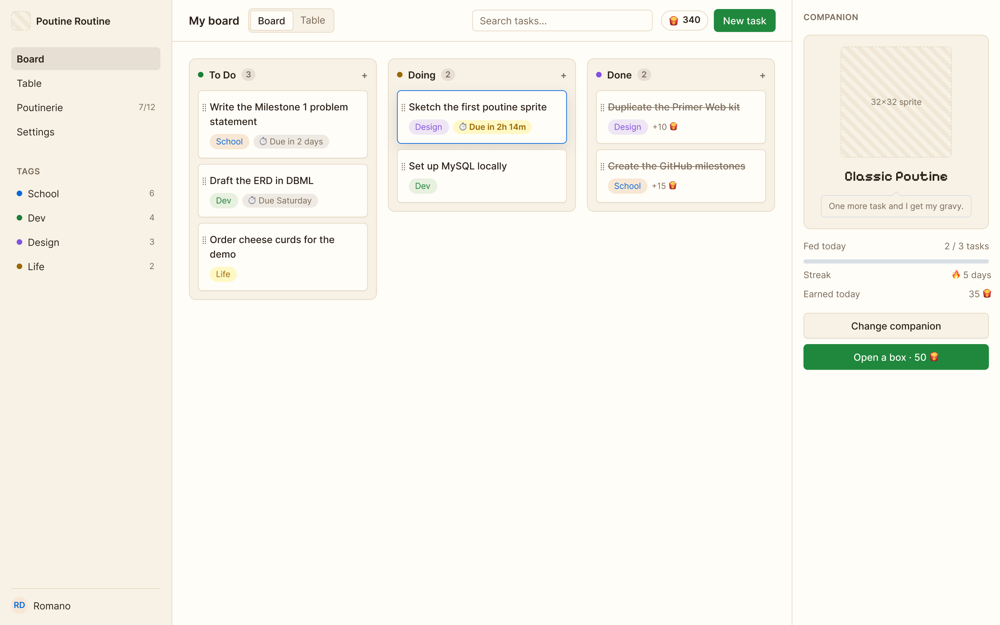
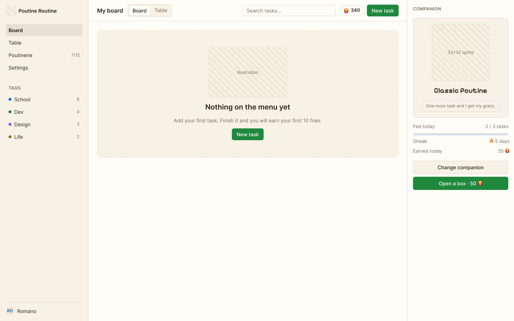
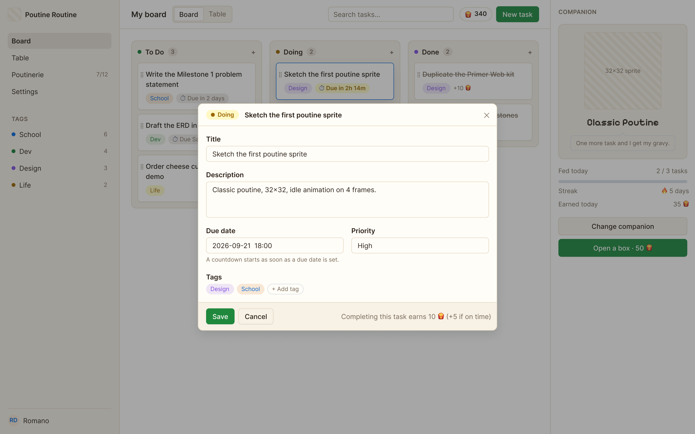
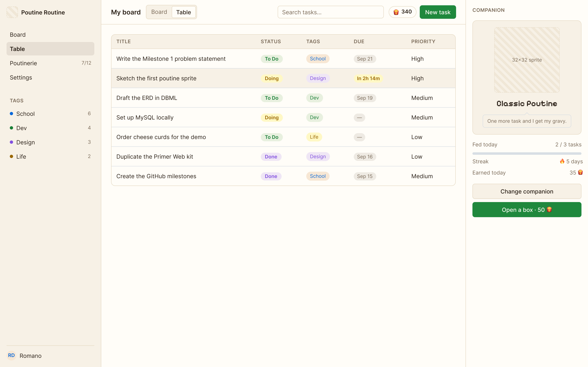
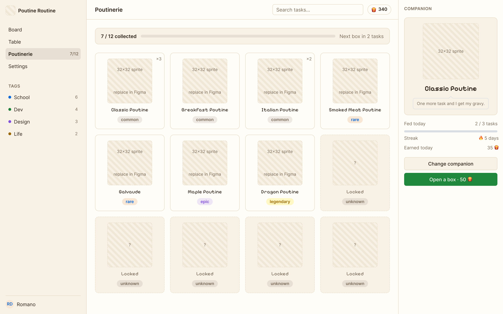
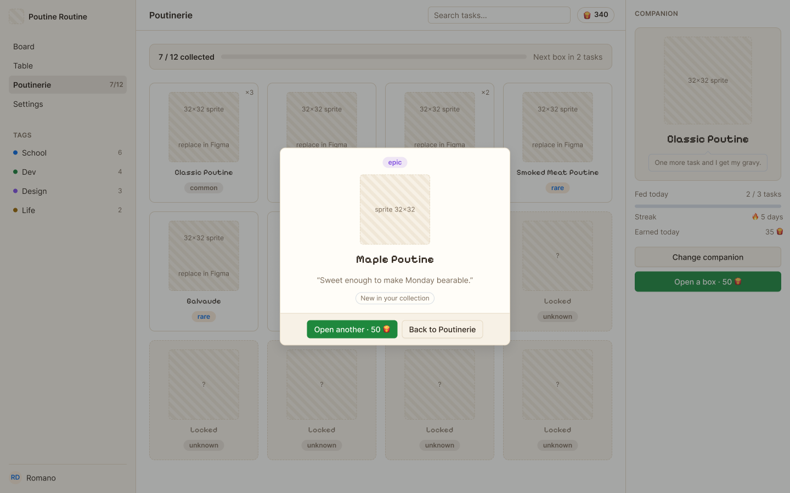
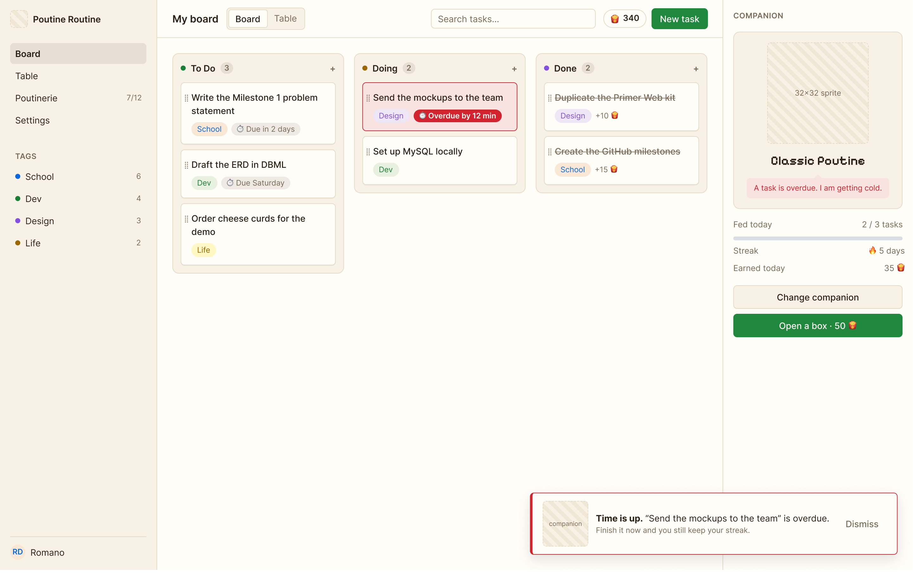
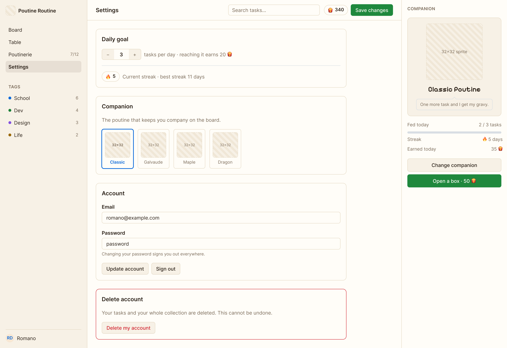

# Front-end mockups

We first wrote the screens in HTML and CSS. We then imported them into Figma, where they are
editable and linked as a clickable prototype. The colours are the real values of the future
client.

The colours and the controls come from GitHub Primer, including the board colours: green for To
Do, amber for Doing, purple for Done. The layout comes from Notion: a left sidebar, a wide content
area, few borders. The collection uses pixel art and a pixel font. The work area stays sober, the
reward area does not.

Colours are design tokens in two layers, structure and palette. One file changes the whole theme.
Four palettes exist today. Tailwind v4 will use the same token names.

## Authentication

## Tasks

## Collection

## States

