# Screens

The images in this chapter are screenshots of the real application. They replace the mockups of
Milestone 1. Each screen keeps the number of its mockup (01 to 10). Screens 11 to 14 are new.

The look follows the mockups: a left sidebar, a wide content area, and a right column for the
companion. The colours and the fonts are the same.

## Authentication

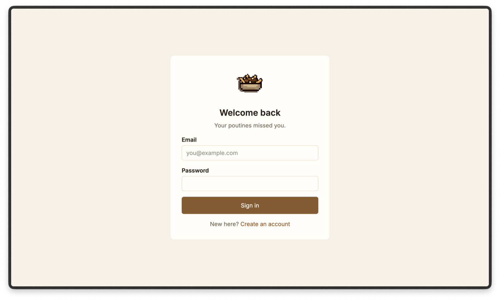

The user enters an email and a password. Empty fields show a message. The form does not call an
API yet. Login and register use the whole screen, without the sidebar.

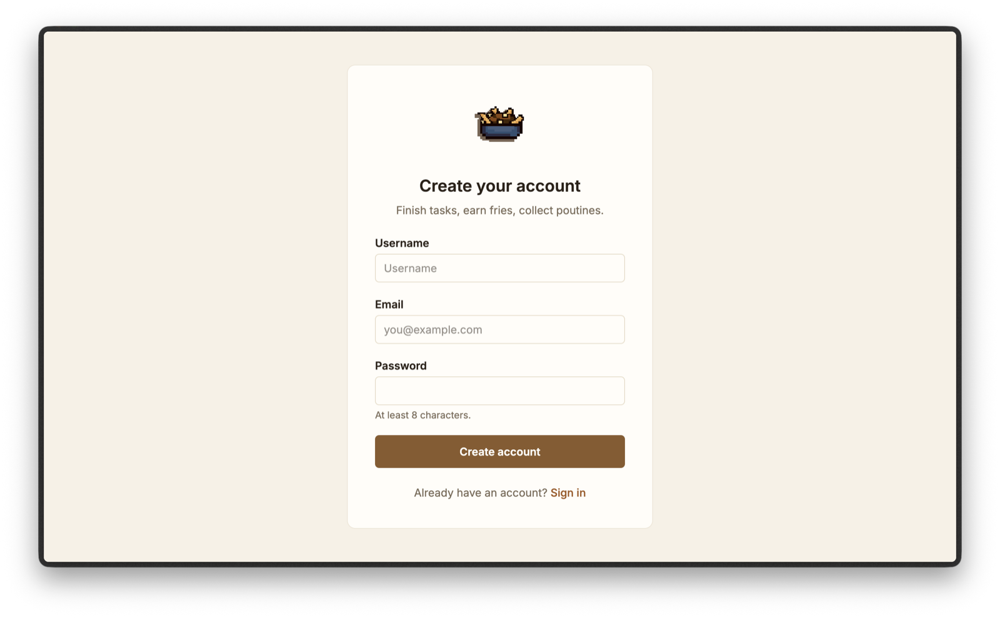

## Tasks

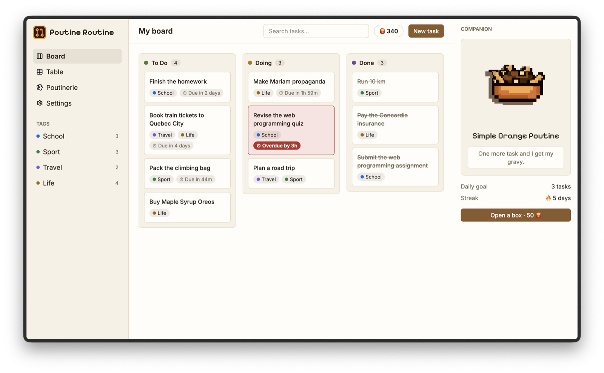

The board has three columns: To Do, Doing and Done. A card shows the title, the tags and the time
left. Clicking a card opens the task form. Dragging a card to another column changes its status.
Only the middle part of the page scrolls.

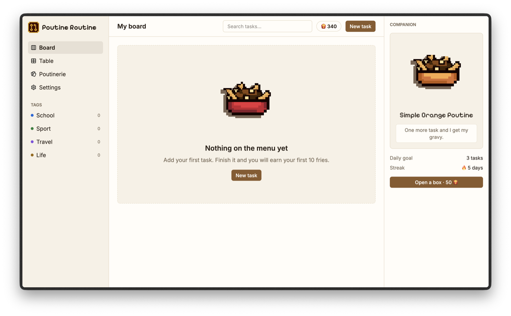

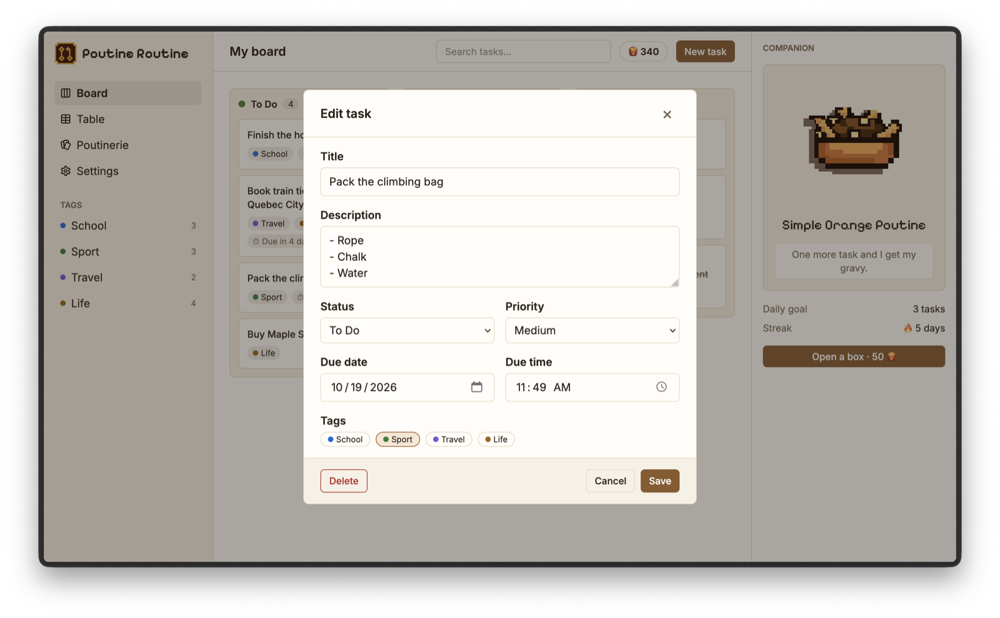

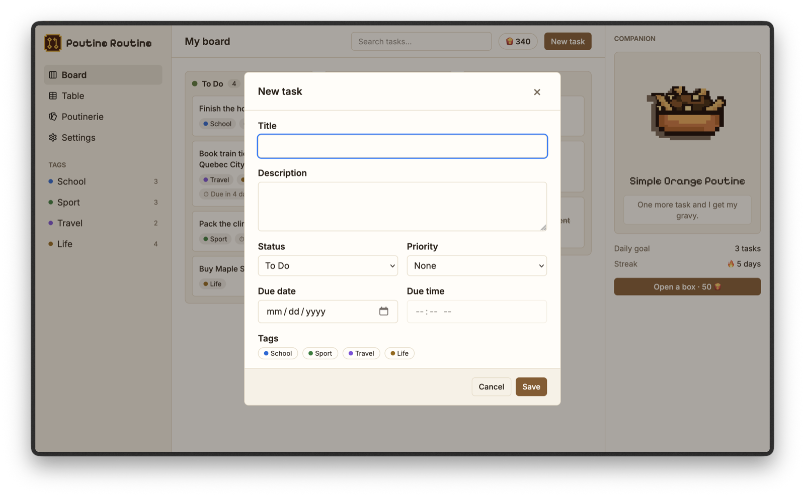

The same form creates and edits a task. A due date without a time means the end of that day.
Escape and a click outside close the form, and the focus returns to the button that opened it.

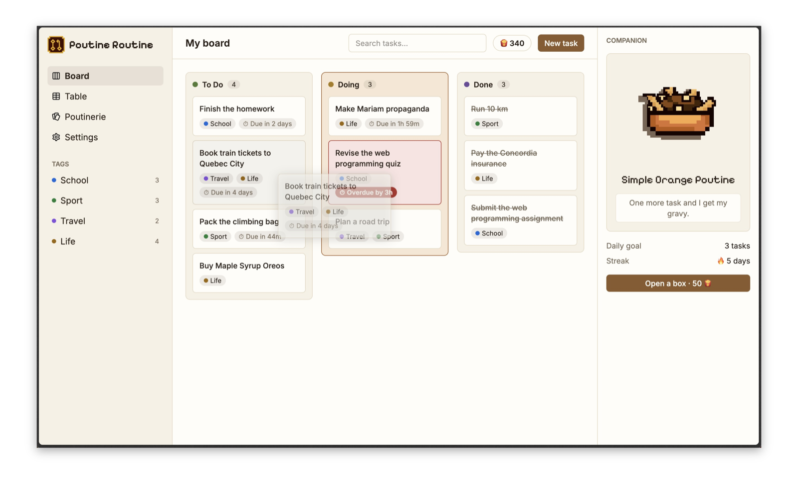

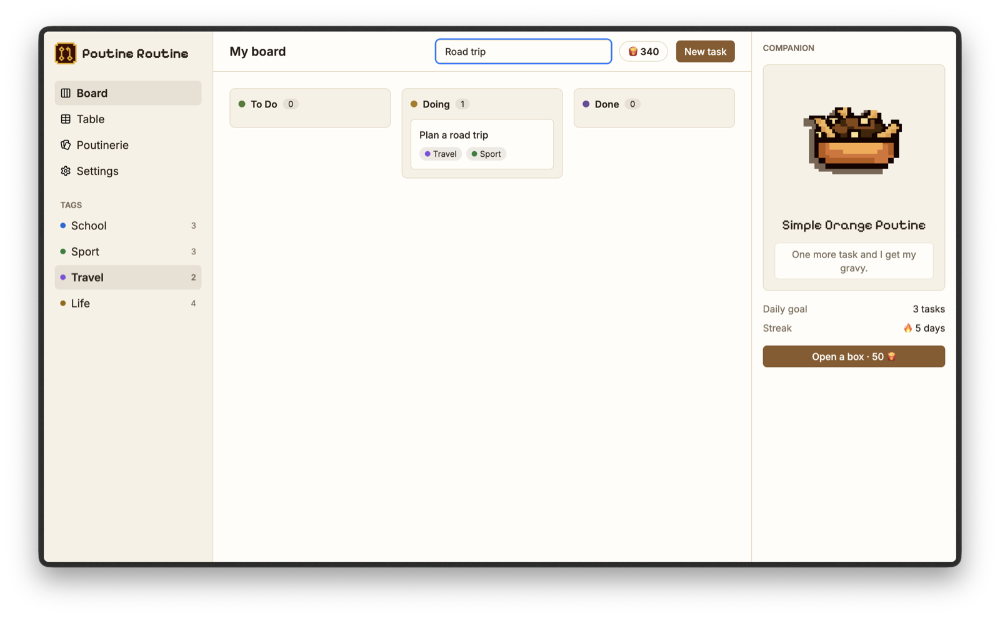

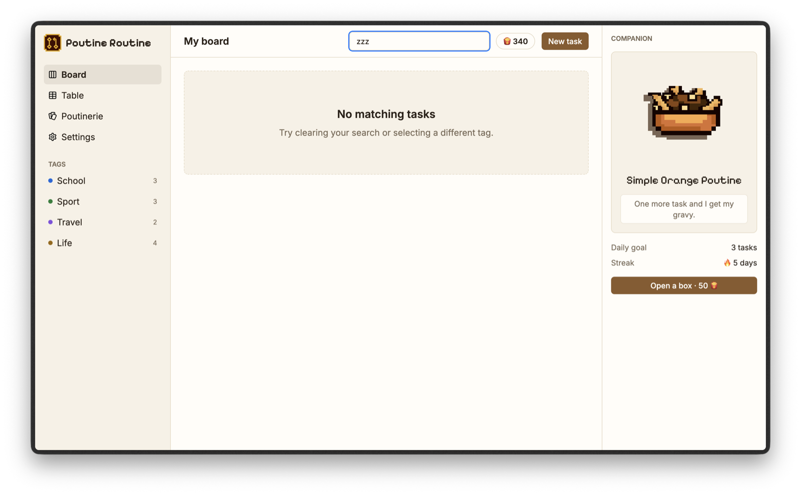

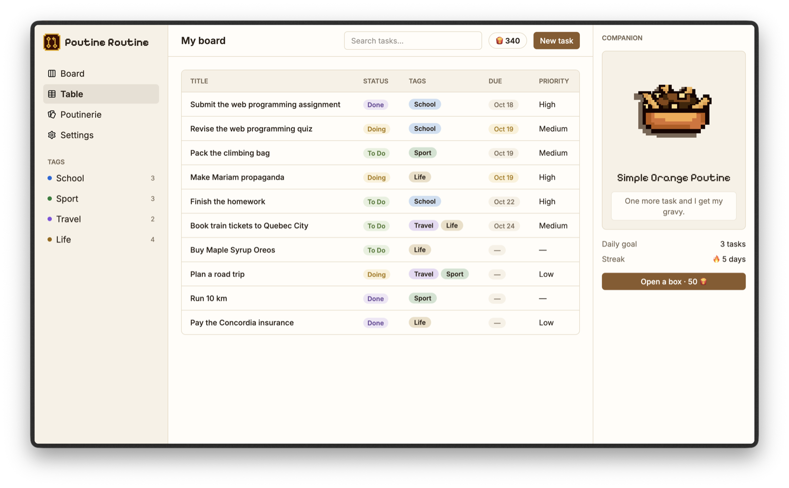

The table shows the same tasks as the board, with the same search and tag filter. A new task
created on the board appears in the table at once, because both read the same store.

## Collection

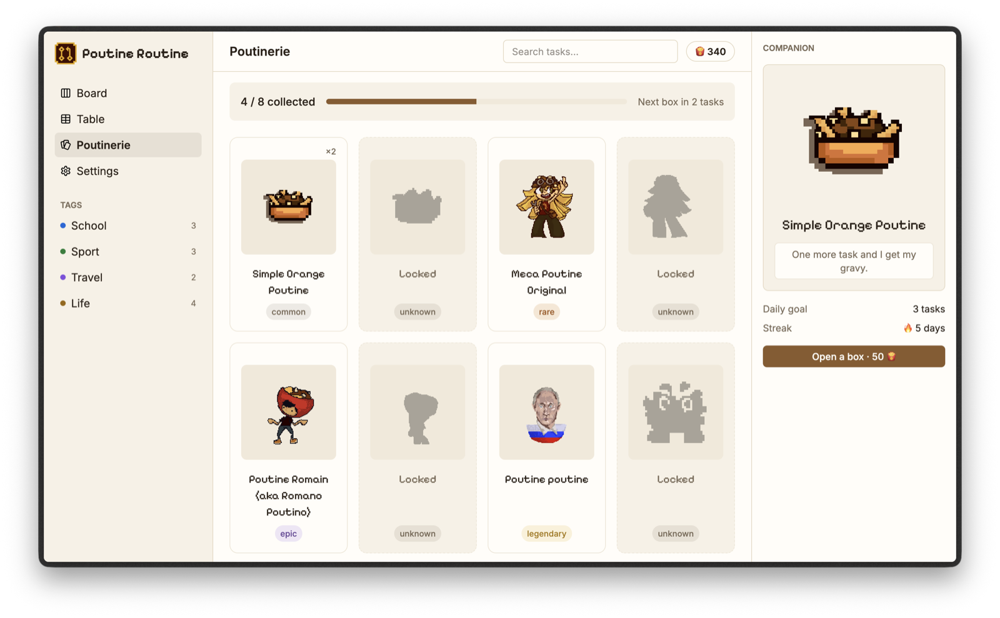

The poutinerie shows the whole catalogue and how many poutines the user owns. A poutine the user
does not own is a black silhouette, with no name and no rarity.

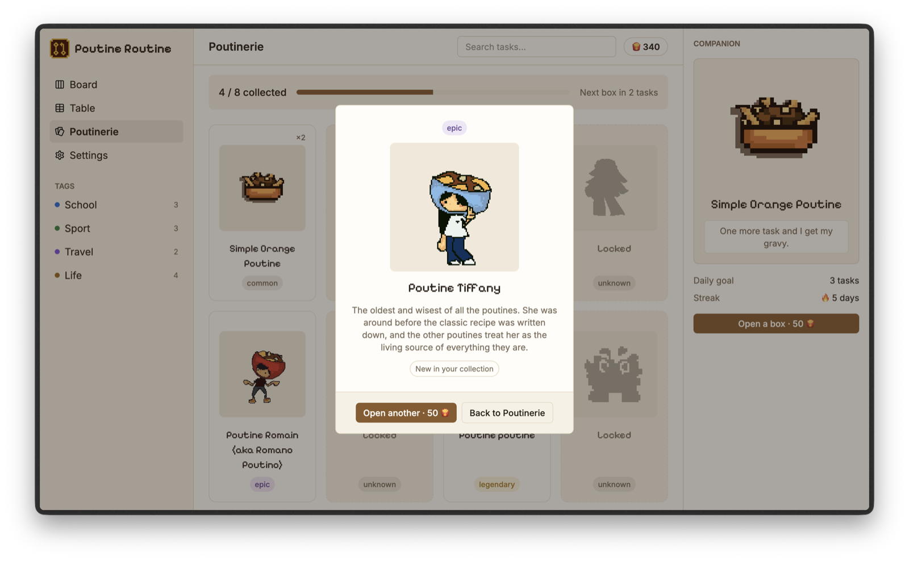

## States and settings

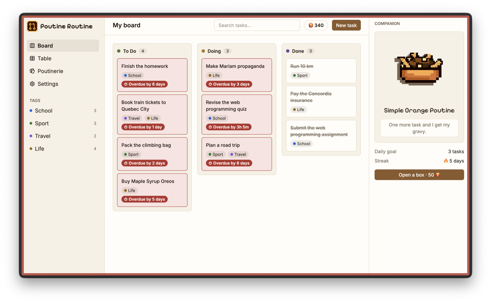

When a task passes its due date, its card turns red and the label says "Overdue by". The edge of
the screen pulses red twice. Nothing moves if the system asks for less motion.

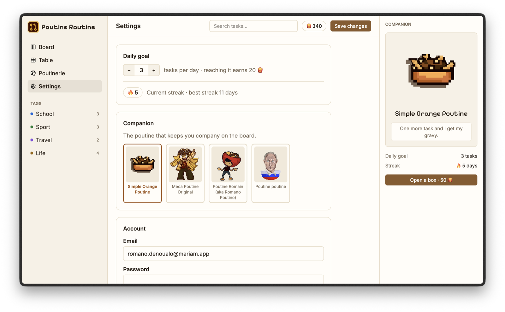

## Differences from the Milestone 1 mockups

The screens are close to the mockups. Here is a list of the small differences:

- **Left for Milestone 3 because they need the backend.** The "+10 fries" label on done tasks,
  the "Fed today" bar and the "Earned today" line in the right column, the "Change companion"
  button, the live "Next box in 2 tasks" message, and the "Time is up" message when a task is
  late.
- **Simplified on purpose.** The Board and Table pages are two links in the sidebar, not a switch
  at the top. The task form has a Status field, so the keyboard can move a task. The date and
  the time are two fields. The columns have no "+" button and the cards have no drag handle.
- **Added.** Sidebar icons, tags that filter the board with a task count, a search box that
  works, and real pixel art in place of the grey boxes.
