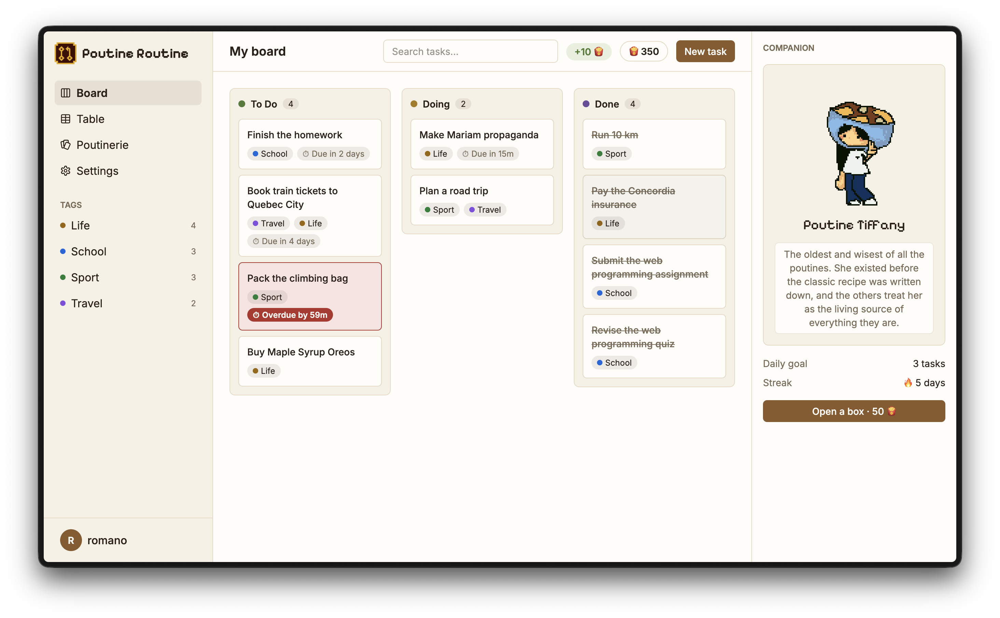
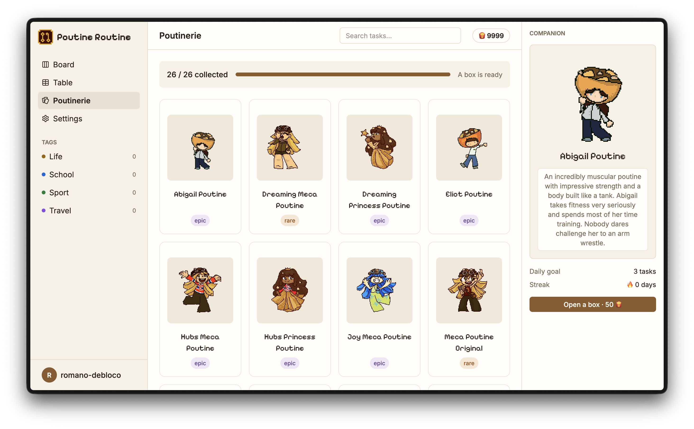
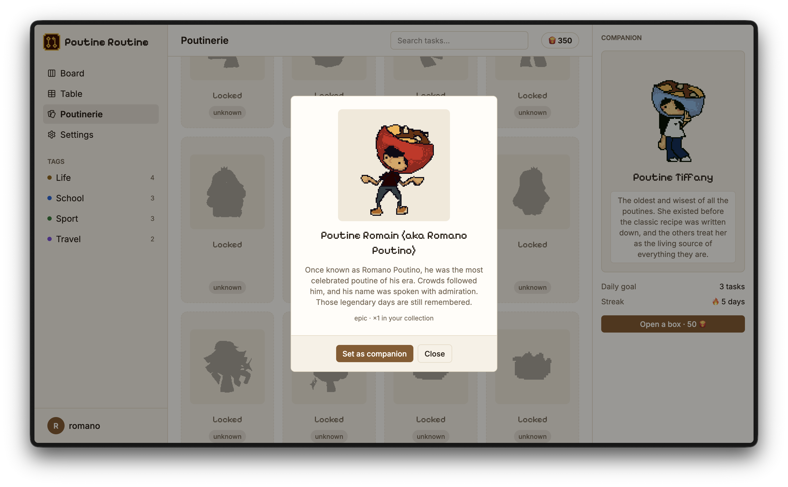
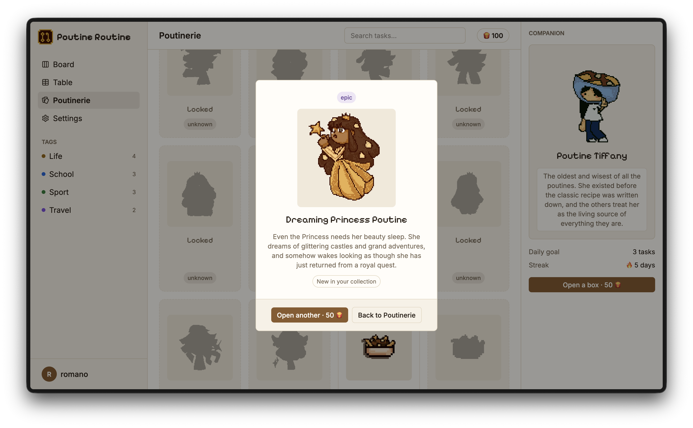
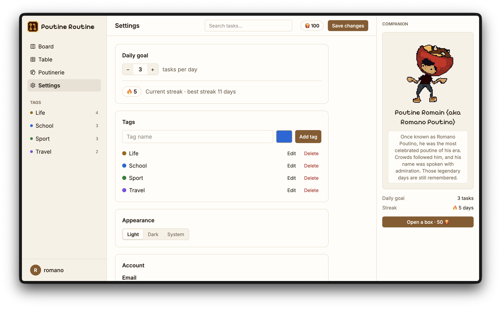
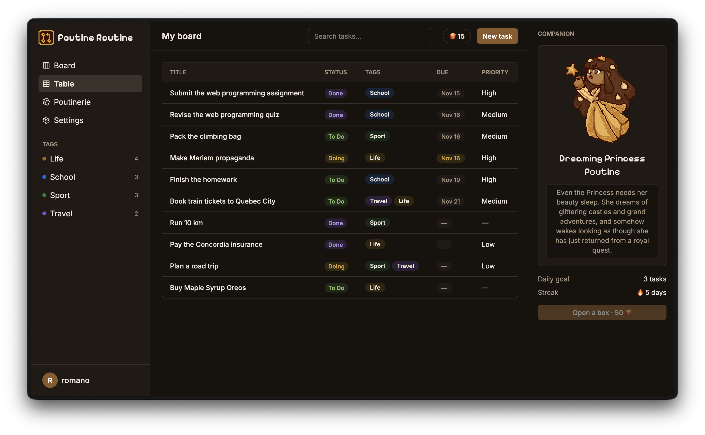

# Screens

The screens of Milestone 2 are still there. These captures show what is new in Milestone 3. They
use a test account of the seed.

## Board and fries

## Collection

## Settings

## Dark theme

